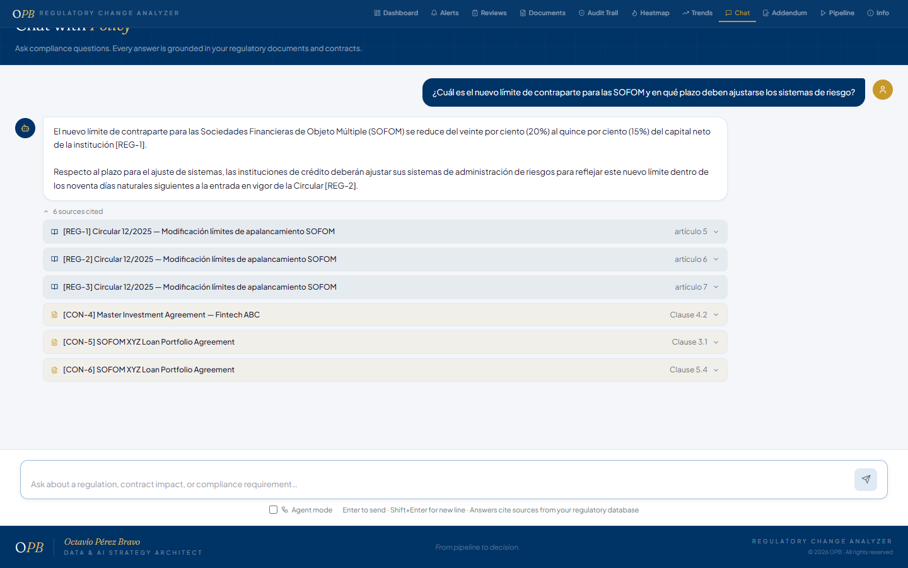
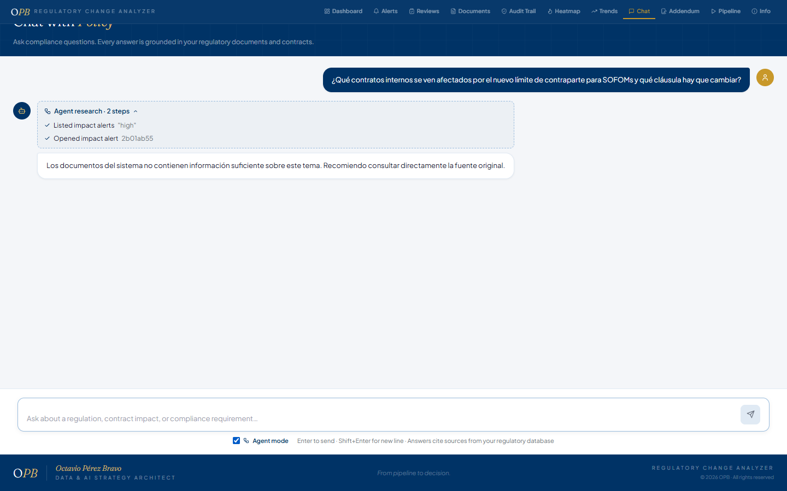
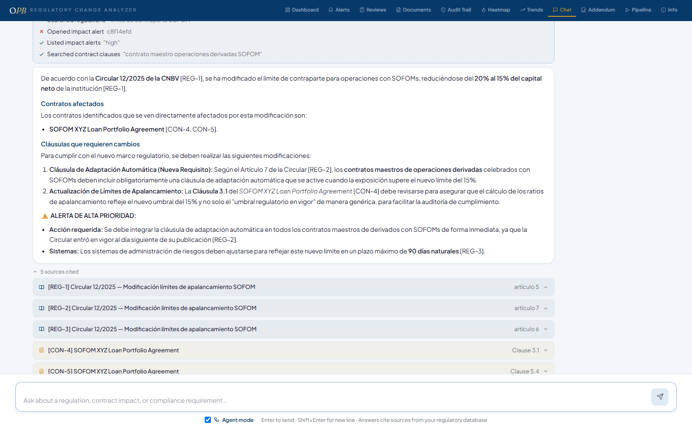
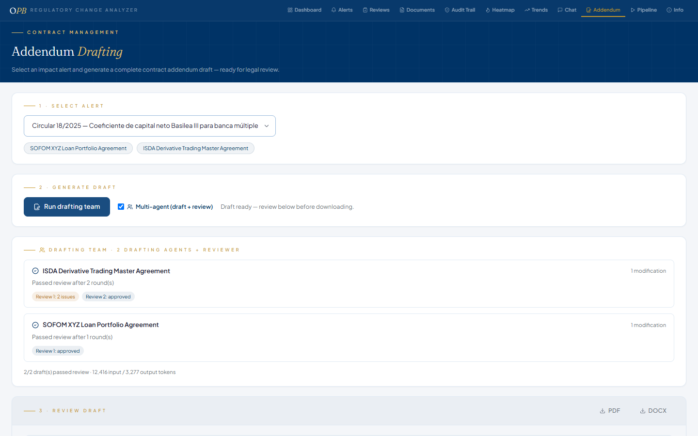
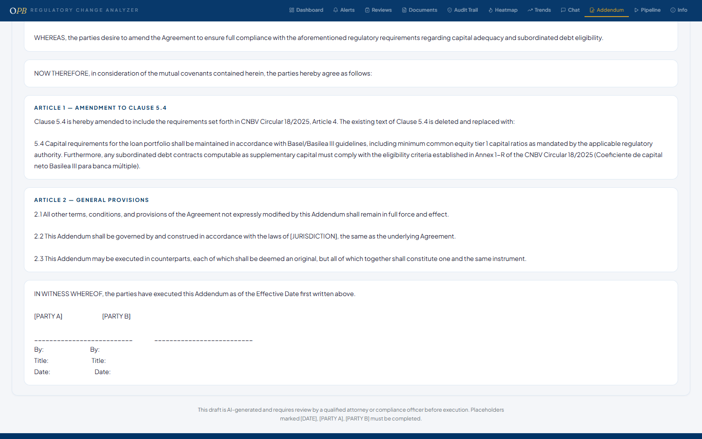

# Applied AI

Where the system uses AI, where it deliberately does not, how each technique is constrained, and what
the measurements say. The guiding principle: **deterministic code owns every decision that can be
checked; models are used only where language understanding is irreplaceable, and their output is
verified before it reaches a person.**

---

## 1. Map of techniques

| Stage | Technique | Model | Why this and not more |
|---|---|---|---|
| Change detection | difflib section diff, regex extraction, rule-based classification | none | Auditable and deterministic; a figure moving 20% → 15% must never depend on sampling |
| Regulation identity | Circular-number parsing (`regulation_id.py`) | none | Which document is "the previous version" is a fact, not a guess |
| Impact mapping | 8 bilingual keyword rules **+** clause similarity | `bge-m3` embeddings | Rules catch contract types; embeddings catch reworded clauses ("exposure limit" ≈ "límite de contraparte") |
| Cross-jurisdiction | Embedding candidates, then shared-domain rule filter | `bge-m3` | Similarity alone links unrelated rules that both mention "effective date" |
| Trends | Pattern extraction over proposed rules / no-action letters | none | Horizon and domain come from explicit text (comment periods, keywords) |
| Policy chat | Retrieval-augmented generation with citation validation | LLM + `bge-m3` | Language understanding needed; grounding enforced by code |
| Research agent | Tool use over 7 read-only DB tools | LLM | Multi-hop questions (circular → alert → contract → SEC) |
| Addendum drafting | Single-call or multi-agent draft + review | LLM | Legal drafting; always a draft for an attorney |

## 2. Models and providers

| Role | Default | Alternatives |
|---|---|---|
| Embeddings | `bge-m3` via Ollama (multilingual, 1024 dims, 8k window) | `all-MiniLM-L6-v2` via sentence-transformers (English-only, 384) |
| LLM | `claude-opus-5-5` (when a key is set) | `gemma4:26b-a4b-it-qat`, `qwen3:4b-instruct-2507-q4_K_M` via Ollama |

Local models run at temperature 0 with a fixed seed and without "thinking", for reproducibility. The
Ollama adapter exposes the same interface as the Anthropic client, so feature code is provider-blind
(see [ENGINEERING.md ED-04](ENGINEERING.md#ed-04-one-client-interface-over-claude-and-ollama-two-phase-tools--schema-on-ollama)).

## 3. Retrieval: hybrid and calibrated

Two arms, fused by **reciprocal-rank fusion** (k=60). Fusion uses ranks only, never raw scores, and
breaks ties by id so runs are reproducible.

- **Semantic arm.** bge-m3 cosine over regulatory changes and contract clauses, kept only above a
  similarity floor.
- **Keyword arm.** ILIKE hit count over the question's meaningful words.

The floors were **measured, not guessed**. Nine eval questions and six unrelated probes, in Spanish and
English, were scored against every article and clause:

| | Covered questions → correct article | Unrelated questions → best article | Floor chosen |
|---|---|---|---|
| Regulatory changes | 0.577 – 0.853 | ≤ 0.50 | **0.52** |
| Contract clauses | relevant hits 0.51 – 0.58 | ≤ 0.535 | **0.55** |

For the clause mapper, the 132 change×clause pairs had a maximum of 0.675 and a median of 0.50. The
six pairs at 0.60 or above were all real matches when read: for example, Circular 12 art. 5,
"20% counterparty limit", against the Master Investment Agreement 4.2, "exposure limit shall not exceed
20%". That gives severity thresholds of 0.60 for medium and 0.70 for high. Cross-lingual cosines run
lower than MiniLM's monolingual ones, which is why the old 0.65/0.80 found almost nothing.

## 4. Grounding: the model is verified, not trusted

Every chat and agent answer goes through `services/grounding.py`:

1. **Nothing retrieved, no model call.** The system returns a fixed refusal in the language of the
   question.
2. **Validation** is a pure function. It checks that every `[REG-n]`/`[CON-n]` tag was shown to the
   model, that example markers such as `[REG-N]` are absent, and that there is at least one citation.
3. **One regeneration**, with feedback written by code: which tags were invalid, and the list of
   allowed tags.
4. **Still failing, or the model declined in prose?** The system writes the refusal itself. The model
   never phrases it.

| Grounded answer (gemma, RAG) | System refusal (qwen, agent gave up) |
|---|---|
|  |  |

**What the validator does not prove:** faithfulness. A correct tag attached to an inverted paraphrase
passes. That residual risk is why every output is reviewed by a person and why the drafting team has a
separate reviewer.

## 5. Agents

**Research agent.** The model chooses which lookups to chain. In the example below (gemma) it listed and opened impact
alerts and searched the contract clauses (one lookup failed and it recovered), then answered with
validated citations to three articles of Circular 12/2025 and the affected loan-agreement clauses.

**Drafting team.** One drafter per affected contract runs in parallel. Each brief already holds the
regulation text and the full contract, loaded by code. An independent reviewer checks five criteria
(coverage, accuracy, fidelity, consistency, form) and returns structured issues. Blocker and major
issues send the draft back to the same drafter. In this run the ISDA draft passed on round 2, after
the reviewer raised 2 issues.

The design choices come from what small models actually did, not from what we expected them to do:

- **gemma's drafter never used its tools** and invented "Clause [X]". So the brief now loads the
  contract by code. Real clause references went from 2/9 to 9/9.
- **qwen's reviewer approved every draft in round 1.** A small model is a weak reviewer. The team still
  pays off because the reviewer is a *different call* with a *different instruction*. With gemma it
  catches real issues, such as an invented obligation or a non-existent clause.
- **Orchestration is code.** An LLM orchestrator would only re-decide something deterministic: one
  drafter per contract.

## 6. Evaluation

The harness lives in [evals/](../evals/README.md). It drives the real HTTP endpoints and grades with
code; there is no LLM judge. The corpus is 3 synthetic CNBV circulars and 6 demo contracts, with 9 Q&A
cases, 2 of them multi-hop and 2 unanswerable.

What each suite checks:

| Suite | Checks |
|---|---|
| RAG and agent | expected facts present; citations valid; refusal on unanswerable questions |
| Addendum and team | structure; names the contract; cites the circular; no percentage absent from the sources; cites a real clause |

Results with the local models (2026-11-25):

| Suite | Before (qwen / gemma) | + grounding & code-loaded brief | + bge-m3 hybrid |
|---|---|---|---|
| RAG chat | 5/7 / 5/7 | 5/7 / 5/7 | **7/7 / 7/7** |
| Research agent | 6/9 / 8/9 | 5/9 / 8/9 | 5/9 / **9/9** |
| Addendum (single call) | 9/9 / 7/9 | 9/9 / 7/9 | 7/9 / 7/9 |
| Addendum cites a real clause | 1/9 / 2/9 | **9/9 / 9/9** | 9/9 / 9/9 |
| Invalid citations blocked before the user | not checked (qwen cited a never-seen `[CON-7]` in an earlier run) | checked: 0 seen | checked: 0 seen |

How to read the numbers:

- **Sample size.** 9 cases: one case moves a rate by more than 10 points, so differences of one case
  are noise.
- **The 7/9 addendum results** come from a strict grader rule. The drafts write "Master Investment
  Agreement" and treat "Fintech ABC" as `[PARTY B]`, which the grader counts as not naming the
  contract.
- **Model profile.** gemma is the stronger agent: it chains lookups and handles every multi-hop case.
  qwen is several times faster (RAG p50 0.4 s vs 3.2 s with keyword retrieval) and good at single-call drafting, but it gives up on multi-hop questions.
- **Claude.** Not evaluated yet, because no API key was configured. The runner supports
  `--model anthropic:claude-opus-5-5`.

## 7. Responsible-AI boundaries

- **Human in the loop.** Impact items, suggestions and addenda are recommendations. Approval, editing
  and export are human actions, behind RBAC.
- **Read-only agents.** No tool can write.
- **Data stays local by default.** Embeddings and the local LLMs run on Ollama. Claude is opt-in per
  deployment.
- **Refusal is a first-class output.** It is never an error, and the model never writes it.
- **Audit everything.** Ingestion, analysis, mapping and review decisions are logged append-only.
- **Honest limits.** The cases are synthetic and developer-written, with no lawyer review. The
  validator proves provenance, not legal correctness.
