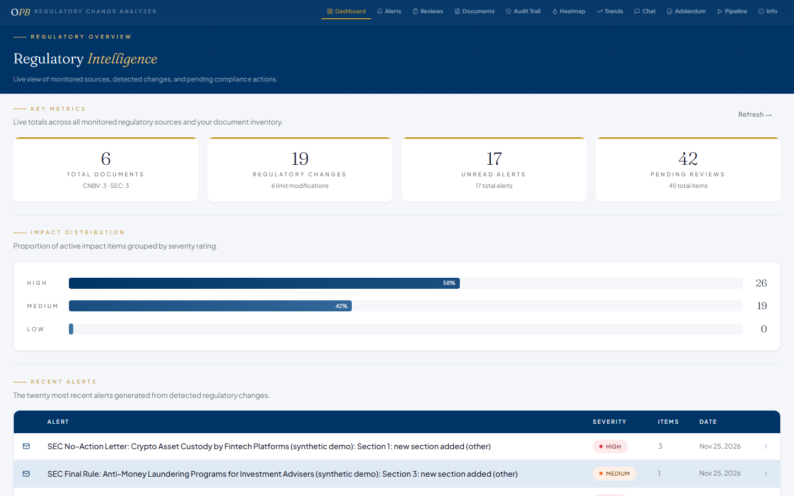
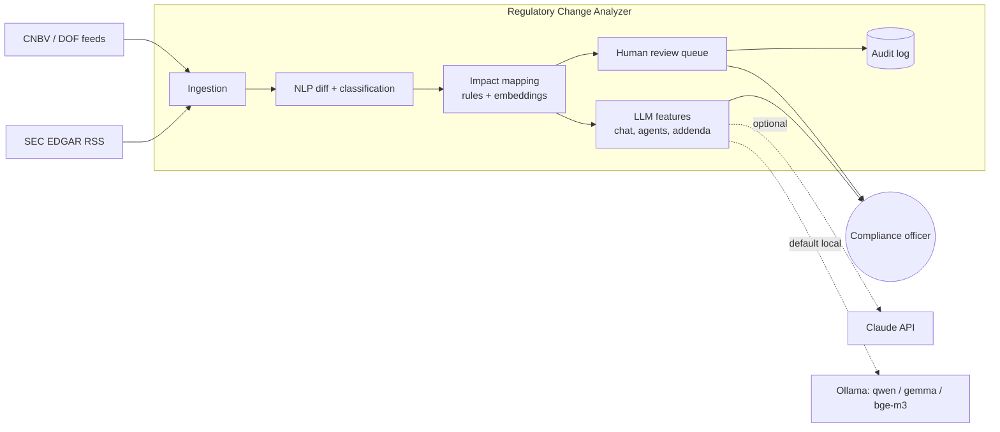
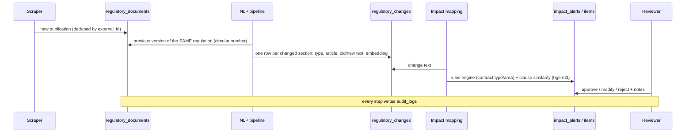
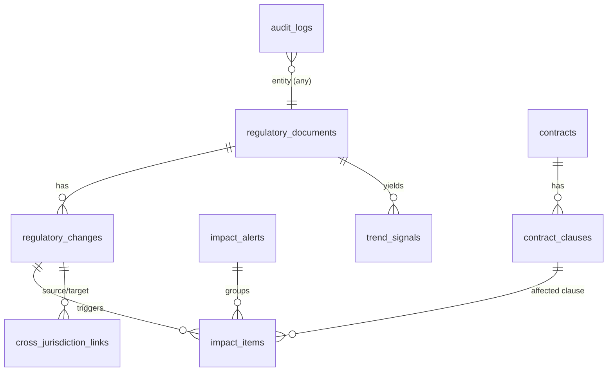
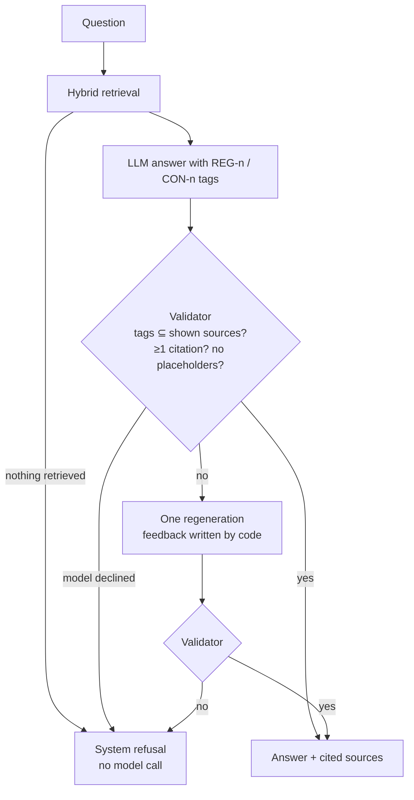

# Architecture

How the Regulatory Change Analyzer is put together: the components, how data moves through them, where
the AI sits, and which boundaries the design protects. For conventions and how to work on the code,
see [ENGINEERING.md](ENGINEERING.md). For the AI techniques in depth, see [APPLIED_AI.md](APPLIED_AI.md).



---

## 1. System context

The system watches two regulators, the CNBV (Mexico) and the SEC (United States). It turns each new
publication into discrete, classified changes and maps every change to the institution's own contracts.
A compliance officer reviews each impact before anything happens. Every step lands in an append-only
audit log.



Two kinds of model provider are supported, and both are optional:

- **Ollama** runs locally. It serves the `bge-m3` embedder and, if chosen, the LLMs (qwen3 4B, gemma4 26B).
  Nothing leaves the machine.
- **Claude** (`claude-opus-5-5`) is used only when `ANTHROPIC_API_KEY` is set and `LLM_PROVIDER=anthropic`.

Without any model, the core workflow (ingestion, diff, rules mapping, review, audit) still runs.

## 2. Components

| Layer | Path | Responsibility |
|---|---|---|
| HTTP API | `src/api/routers/` (15 routers) | FastAPI. RBAC on every route except `/health`. SSE for streaming features |
| Services | `src/services/` | Orchestration: ingestion, NLP, impact, RAG, addenda, exports, heatmap, trends, cross-mapping |
| Repositories | `src/repositories/` | Database access (async SQLAlchemy) |
| Ingestion | `src/ingestion/` | CNBV and SEC scrapers. Dedup by a stable `external_id` (SHA-1 of the URL) |
| NLP | `src/nlp/` | Section splitter, difflib comparator, entity extractor, change classifier, regulation identity, trend extractor |
| Mapping | `src/mapping/` | Rules engine (R001–R008), embedder, semantic clause mapper, cross-jurisdiction mapper |
| Retrieval | `src/services/retrieval.py` | Hybrid search (semantic + keyword, rank-fused) shared by chat and agent tools |
| Grounding | `src/services/grounding.py` | Citation validator and the system-written refusal |
| LLM access | `src/services/llm.py`, `ollama_client.py` | One client interface over Claude or Ollama |
| Agents | `src/agents/` | Tool-use loop, read-only DB tools, research agent, drafting team |
| Worker | `src/worker.py` | Celery + beat: the daily scrape |
| Frontend | `frontend/` | React + Vite + Tailwind, 11 pages |
| Evals | `evals/` | Code-graded model comparison through the real endpoints |

## 3. The pipeline, step by step



1. **Ingest.** Scrapers fetch new items. PDF and DOCX files are parsed off the event loop.
2. **Find the baseline.** `regulation_key()` reads the circular number from the title, for example
   "Circular 12/2025" or "Circular Única de Bancos". The document is diffed only against an earlier
   version of the same regulation. A title without an identifier is analysed on its own, because
   diffing it against an unrelated circular would invent repeals.
3. **Diff and classify.** Sections are compared with difflib. A change ratio as small as 0.02 counts,
   since one figure moving from 20% to 15% matters. Each change gets one of six types: new_requirement,
   limit_modification, repeal, clarification, deadline, other. Numeric changes are matched by position.
4. **Map impact.** Two independent paths:
   - the **rules engine**: 8 bilingual rules covering SOFOM/credit, derivatives, AML/PLD, data privacy,
     fintech, reporting, capital/Basel and funds. It flags contracts by type and area.
   - **clause similarity**: pgvector cosine with bge-m3 embeddings. It flags specific clauses.
5. **Review.** The impact items sit in a queue. Nothing is applied without a human decision, and every
   decision records the reviewer and their notes.
6. **Derived views.** These are built from the same data:
   - the risk heatmap, by department;
   - trend signals from proposed rules and no-action letters;
   - CNBV↔SEC cross-jurisdiction links;
   - exports to XLSX, PDF and DOCX;
   - Jira/Asana tasks.

## 4. Data model



- `regulatory_changes.embedding` and `contract_clauses.embedding` are `vector(EMBEDDING_DIM)`.
  The default is 1024, for bge-m3. Changing the embedder means running `alembic upgrade head` and
  then `scripts/reembed.py`. A startup check compares the column size with the configuration; on a
  mismatch it disables embeddings instead of letting inserts fail.
- Every timestamp is `timestamptz` (UTC).
- The schema comes from `init_db()` (`create_all`). Alembic adds indexes, tables and the
  embedding-dimension change on top, idempotently. That includes an HNSW index on clause embeddings.

## 5. Retrieval

The policy chat and the agent's search tools share one retriever:

```
question ──► bge-m3 ──► semantic arm: cosine ≥ floor (changes 0.52, clauses 0.55), top 20 ─┐
         └─► keywords ─► lexical arm: ILIKE hit count, top 20 ─────────────────────────────┤
                                                       RRF (k=60, rank-only, ties by id) ◄─┘
                                                       ──► top 5 changes + top 3 clauses
```

bge-m3 is multilingual, so an English question reaches a Spanish circular; the keyword arm cannot do
that. The similarity floors were measured on the eval corpus, not guessed (see
[APPLIED_AI.md §3](APPLIED_AI.md#3-retrieval-hybrid-and-calibrated)). If the embedder is unavailable,
the semantic arm is simply empty and retrieval falls back to keywords alone.

## 6. LLM features and the grounding boundary



The same boundary covers the classic RAG chat and the research agent. The refusal text is fixed and
written by code, in the language of the question; the model is never asked to phrase it. A `reset`
SSE event tells the UI to discard text that was already streamed when an answer is replaced.

**Agents** ([src/agents/](../src/agents/)) run a self-hosted tool-use loop inside the API process,
because every tool is a read-only `SELECT` against this app's database:

- **Research agent** (`POST /agents/chat`). The model chooses which of 7 tools to call (search
  regulations, open a change, cross-jurisdiction links, search clauses, open a contract, list and open
  alerts) for up to 10 steps, then answers with citations that are validated.
- **Drafting team** (`POST /agents/addendum/{alert}`). Deterministic code orchestrates, not an LLM.
  It fans out one drafting subagent per contract, 3 in parallel. Each drafter's brief already holds,
  loaded by code, the full regulation text and every clause of the contract. A reviewer agent returns
  structured JSON issues; blocker and major issues send the draft back to the same drafter, up to 2
  revisions. Database access across the parallel subagents is serialised by an `asyncio.Lock` on one
  shared session.

## 7. Model providers

`src/services/llm.get_client()` returns either `AsyncAnthropic` or `AsyncOllama`. Both expose the
same `messages.stream()` / `messages.create()` surface, so feature code does not depend on the provider.

The Ollama adapter does the following:

- translates tool calls and JSON-schema output;
- forces temperature 0 with a fixed seed;
- turns off "thinking";
- runs any turn that asks for both tools and a schema in two phases. Small models return nothing when
  both are in the same request.

## 8. Security and compliance boundaries

- **RBAC** on every route. There are four roles: viewer, analyst, compliance_officer and admin.
  Anything that spends tokens or writes data needs analyst or higher; exports need compliance_officer.
  A test fails if a route has no role dependency.
- **Agent tools are read-only.** Agents can look things up. They cannot approve, edit or export.
- **Human in the loop.** Impact items and addenda are recommendations; a person decides.
- **Audit trail.** The log is append-only and records ingestion, analysis, mapping and review decisions.
- **Confidentiality.** With the default local providers, contract text never leaves the machine.
  Claude is opt-in.
- **Untrusted text.** ReportLab output escapes all dynamic text, and contract uploads ignore client
  paths.

## 9. Deployment

| Mode | How |
|---|---|
| Local dev | `docker compose up -d` (Postgres + pgvector, Redis), then `uvicorn` and `npm run dev`; Ollama on the host |
| Containers | `docker compose --profile app up -d --build`. API and worker reach the host's Ollama at `host.docker.internal`. The image no longer ships torch; `--build-arg EXTRAS=ml` adds sentence-transformers |
| CI | Lint, unit tests, integration tests on a pgvector service, frontend tests and build, CodeQL, a Docker build smoke test, and Claude review workflows |
