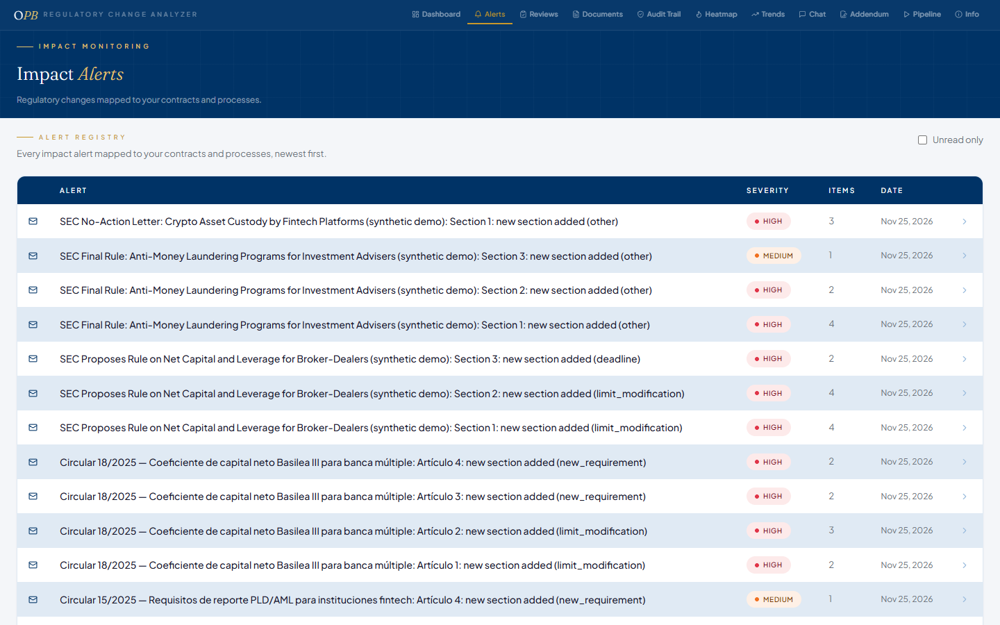
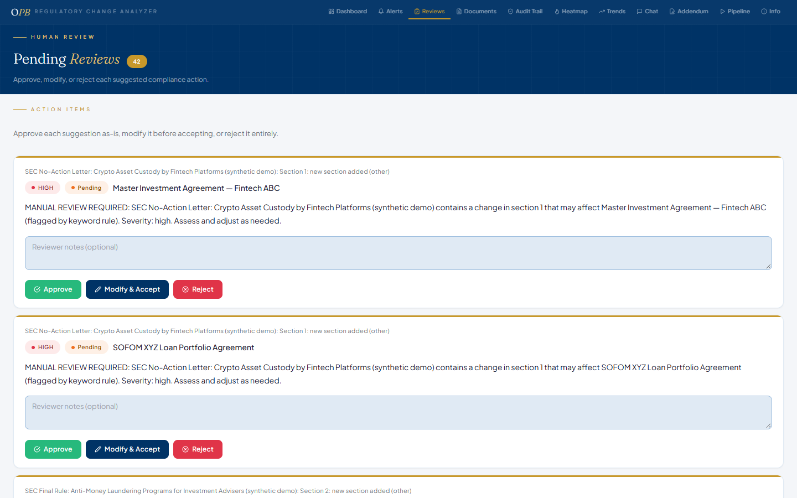
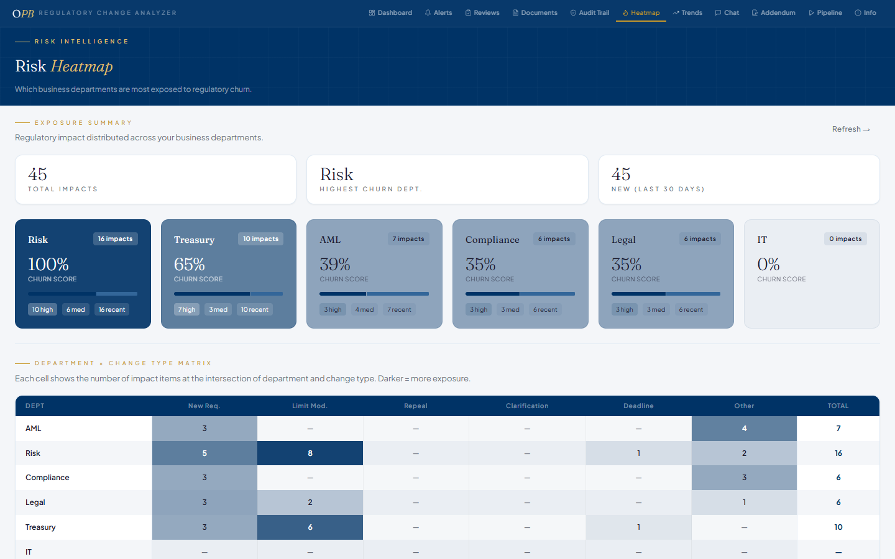
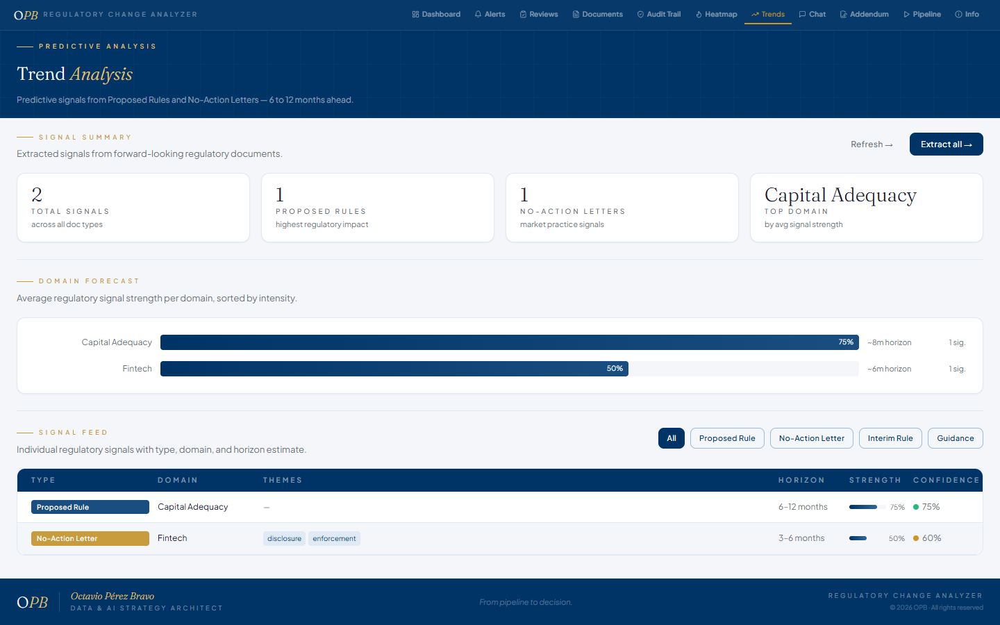
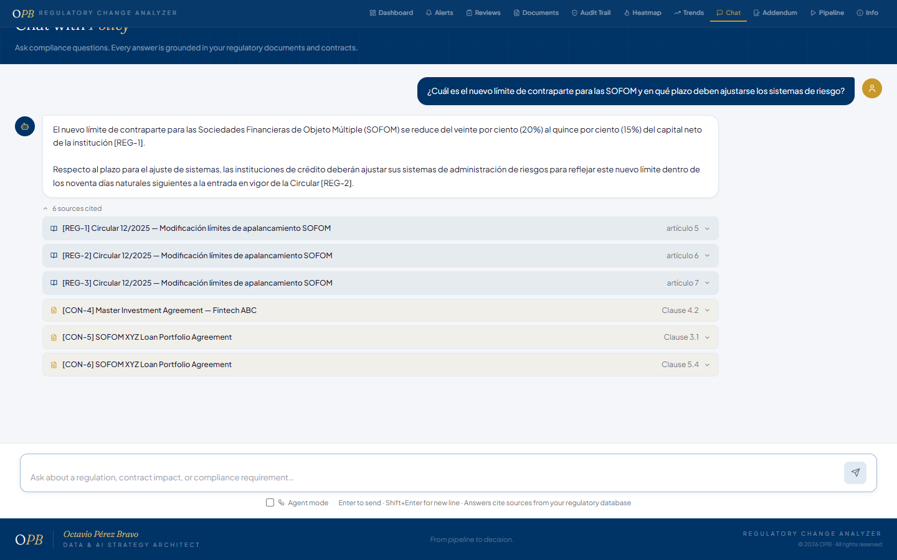
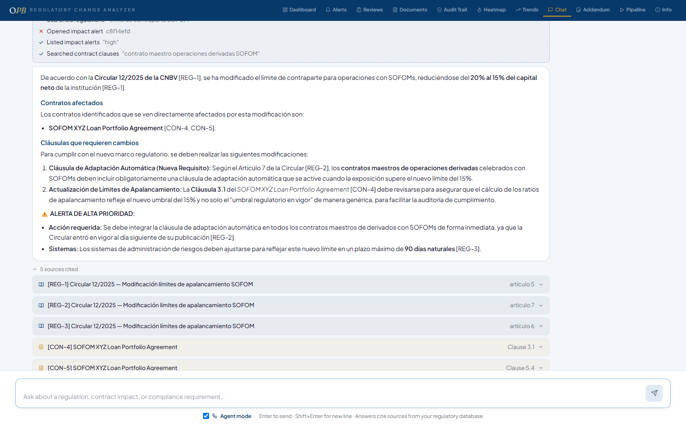
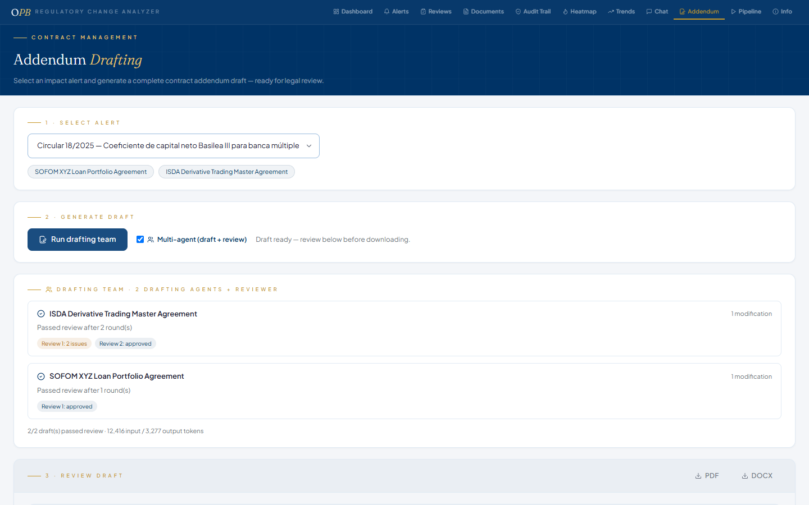

# Business Value

What the Regulatory Change Analyzer is worth to a financial institution, for whom, and with what
limits. This document is for compliance leadership, risk, legal and project sponsors. The full business
case, with TCO, ROI framework, build-vs-buy analysis and market sizing, is in
[planning/Business.md](../planning/Business.md). This page summarises it and updates it for what the
system does today.

---

## 1. The problem in one paragraph

Institutions supervised by the CNBV and the SEC receive a constant stream of circulars, final rules,
proposed rules and no-action letters. Each one may require changes to contracts and processes within a
window of 30 to 180 days. Compliance teams spend most of that window **finding** the change and
**working out which contracts it touches**: reading publications and cross-referencing them by hand
against the contract library. Then they spend more time **proving** to examiners that they did it.
Missed changes, slow assessments and audit trails rebuilt after the fact are the three costs.

## 2. What changes with the system

| Stage | Before | With the analyzer |
|---|---|---|
| Monitoring | Periodic manual checks of regulator sites and newsletters | Daily automated ingestion of CNBV and SEC, with deduplication |
| Triage | Read whole publications to find what changed | Every changed article extracted, classified, and compared with the previous version of *the same* circular |
| Impact assessment | Weeks of cross-referencing regulation text against contracts | Minutes: rules and semantic matching flag the specific contracts and clauses, with severity |
| Decision | Email threads and spreadsheets, unclear attribution | Approve, modify or reject in the app, with the reviewer and notes recorded |
| Drafting | Counsel starts from a blank page | A draft addendum citing the circular and the real clause numbers, checked by a reviewer agent, ready for an attorney |
| Evidence | Rebuilt by hand for the examiner | Append-only audit trail produced as a by-product |

| | |
|---|---|
|  |  |
|  |  |

## 3. Value drivers

1. **Capacity reallocation.** Officers stop *producing* information (reading, cross-referencing) and
   start *evaluating* it. The business case estimates that 60–70% of compliance capacity goes to
   reading and triage today. Reallocating part of it is worth roughly 1–1.5 additional officers for a
   three-person team, without new hires. These are representative benchmarks, not measured savings at a
   client.
2. **A shorter assessment window.** Knowing which clauses are affected within hours of publication
   leaves the 30–180-day window for remediation instead of discovery.
3. **Consistent detection.** The same rules and the same retrieval run on every document. Human triage
   varies by reader and by workload.
4. **Audit evidence at zero marginal cost.** Who saw what, when, and what they decided, available on
   demand for an examination.
5. **Earlier signal.** Proposed rules and no-action letters become trend signals with a 6–12-month
   horizon, which helps budgeting and staffing.
6. **Cross-jurisdiction view.** CNBV changes are linked to their SEC counterparts by shared regulatory
   domain, for institutions that operate in both countries.

## 4. What the AI adds, and how it is kept safe

| Capability | Business use | Safeguard |
|---|---|---|
| **Policy chat** | Ask "what changed for SOFOM limits and by when?" and get an answer citing the article and the clause | Answers must cite sources actually retrieved. If they cannot, the system says the documents do not contain enough information |
| **Research agent** | Multi-step questions: which contracts does this circular hit, and what is the SEC equivalent? | Read-only tools; every step visible; citations validated |
| **Drafting team** | One draft addendum per affected contract, reviewed by a second AI before a person sees it | Drafts are labelled as requiring attorney review; open issues are flagged, never hidden |

| Cited answer | Agent with visible steps | Reviewed drafts |
|---|---|---|
|  |  |  |

**Confidentiality.** Contract text is sensitive. By default the embeddings and the language models run
**locally** on Ollama, so no contract text leaves the institution's environment. Claude can be enabled
per deployment for higher answer quality, as an explicit decision.

**Measured, not claimed.** Each AI feature is evaluated on a fixed set of questions and drafts,
graded by code:

- **Answers to answerable questions.** The cited-answer rate rose from 5/7 to 7/7 after adding
  multilingual search, because English questions now find Spanish circulars.
- **Real clause references.** Draft addenda that cite a contract clause that actually exists rose from
  1–2 of 9 to 9 of 9 after the drafter was given the full contract.
- **Invented citations.** None reached a user in any run after the citation validator was added.

Full results and caveats are in [APPLIED_AI.md §6](APPLIED_AI.md#6-evaluation).

## 5. Cost profile

| Item | Order of magnitude | Notes |
|---|---|---|
| Infrastructure | USD 100–450 / month | Managed Postgres + Redis + one app instance |
| Local AI | Hardware already owned | A workstation GPU runs bge-m3 and a 4B–26B model; no per-query cost |
| Claude (optional) | Cents per query, cents to dimes per draft | Only if enabled |
| Maintenance | 20–40 developer-hours / year | Rule updates, scraper changes, re-calibrating thresholds if the embedder changes |

Infrastructure and maintenance figures come from [planning/Business.md §8](../planning/Business.md#8-total-cost-of-ownership-tco).
Local models replace most of the external API cost and the confidentiality review it would need.

## 6. Who benefits

| Stakeholder | Gets |
|---|---|
| Chief Compliance Officer | Fewer missed changes, an examination-ready trail, a view of workload by department |
| Compliance officers | A prioritised queue instead of a reading list; cited answers to questions |
| Legal / General Counsel | Specific, cited impacts and a first draft instead of "check whether this affects us" |
| Chief Risk Officer | Heatmap of regulatory churn, forward-looking trend signals |
| IT | A standard stack (Python, Postgres, Docker) that can run fully on-premise |

## 7. Limits, stated plainly

- **Not legal advice and not a compliance certificate.** Every impact and draft is an input to a
  professional's judgment.
- **It covers two regulators, CNBV and SEC.** Each further source (CONDUSEF, Banxico, ESMA, FCA) needs a
  scraper.
- **No guarantee of zero false negatives.** A change worded far from any contract clause, and touching
  no rule, can be missed. Human review is a real check, not a rubber stamp.
- **AI quality depends on the model.** The small local model (qwen) gives up on multi-step questions, and
  the system answers with an honest refusal rather than a guess. The larger local model (gemma) handled
  all multi-step cases but is slower.
- **The evaluation set is small and synthetic.** It has 9 questions and no lawyer review yet. A lawyer
  should review the cases before figures are quoted externally.
- **No integration with contract management systems yet.** Approved drafts are exported as PDF or DOCX,
  not pushed into DocuSign CLM, Icertis or Sirion.

## 8. Next steps that add the most value

1. **Lawyer-reviewed evaluation cases** on real (anonymised) circulars and contracts, so quality figures
   can be quoted.
2. **Evaluate Claude** against the local models on the same set, to decide the default per feature on
   evidence.
3. **CLM integration**, so approved addenda go straight into the contract workflow.
4. **More sources**: CONDUSEF and Banxico first, for Mexican institutions.
