# Documentation

| Document | For | What it covers |
|---|---|---|
| [ARCHITECTURE.md](ARCHITECTURE.md) | Engineers, architects | Components, pipeline, data model, retrieval, grounding boundary, agents, providers, security, deployment |
| [ENGINEERING.md](ENGINEERING.md) | Contributors | Stack, layout, running and testing, conventions, CI, engineering decision log (ED-01 – ED-10) |
| [APPLIED_AI.md](APPLIED_AI.md) | AI/ML engineers, reviewers | Where AI is used and where it is not, calibrated hybrid retrieval, citation validation, agents, eval results |
| [BUSINESS_VALUE.md](BUSINESS_VALUE.md) | Compliance, risk, legal, sponsors | Problem, before/after, value drivers, safeguards, cost profile, limits |
| [KNOWLEDGE_LEARNED.md](KNOWLEDGE_LEARNED.md) | Everyone maintaining the system | Lessons from building and evaluating it, lessons imported from Legal_AI_Assistant, open findings |

Also: [evals/README.md](../evals/README.md) (model evaluation), [planning/Business.md](../planning/Business.md)
(full business case), [planning/Decisions.md](../planning/Decisions.md) (original design record).

## Screenshots

Taken on 2026-11-25 from a demo database: the 3 synthetic CNBV circulars, 3 synthetic SEC publications
and 6 demo contracts. LLM features ran on local models through Ollama (gemma4 26B, and qwen3 4B for the
refusal example), with bge-m3 embeddings.

| | |
|---|---|
| **Dashboard** — documents, changes, alerts, pending reviews, severity mix 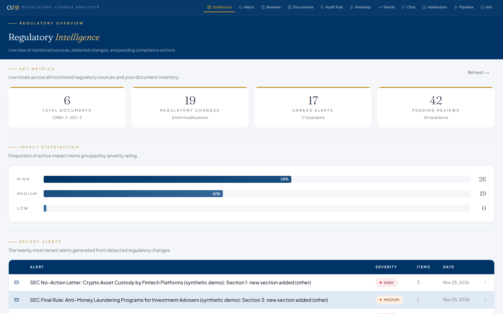 | **Impact alerts** — one alert per changed article, with severity and item count 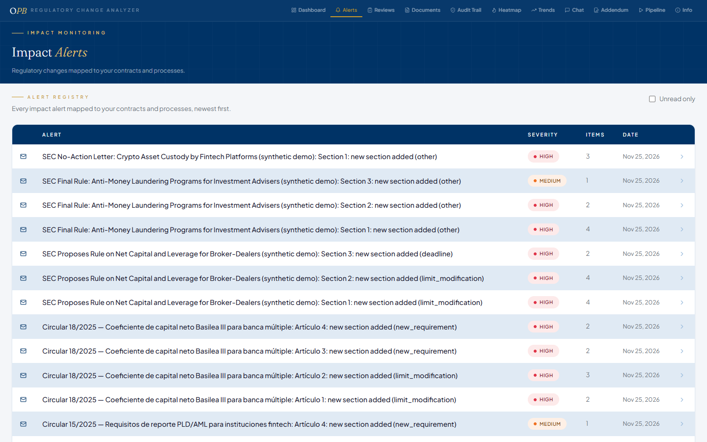 |
| **Review queue** — approve, modify or reject each suggested action 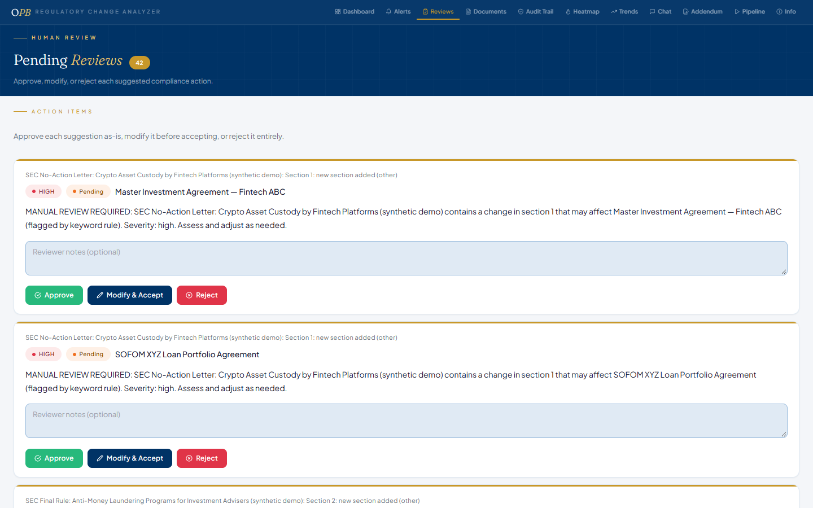 | **Documents** — ingested CNBV and SEC publications 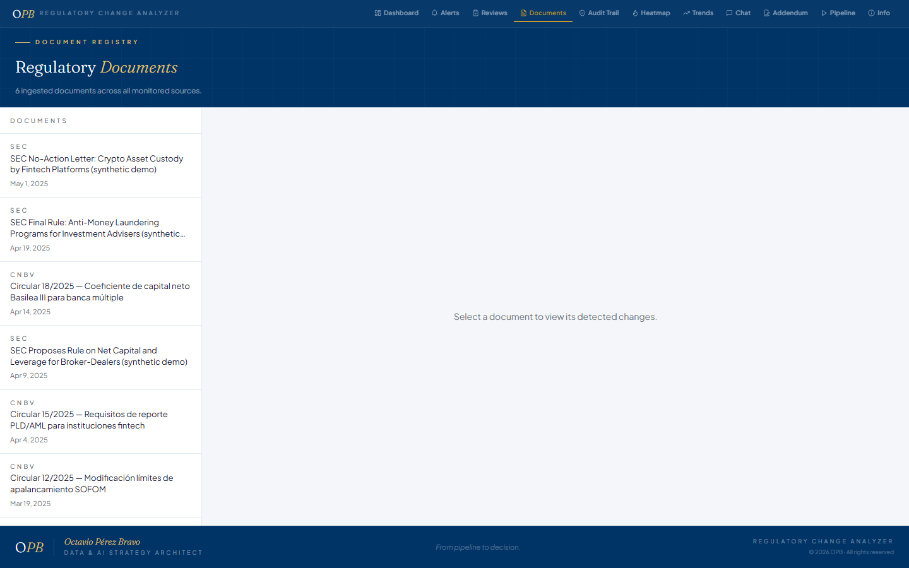 |
| **Risk heatmap** — impacts by department and change type 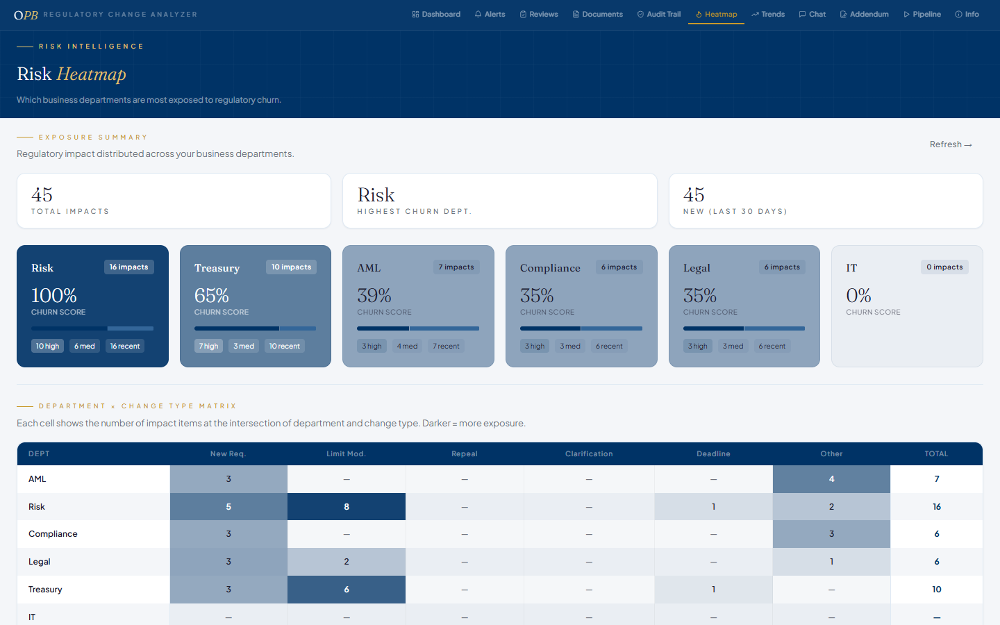 | **Trend analysis** — signals from proposed rules and no-action letters 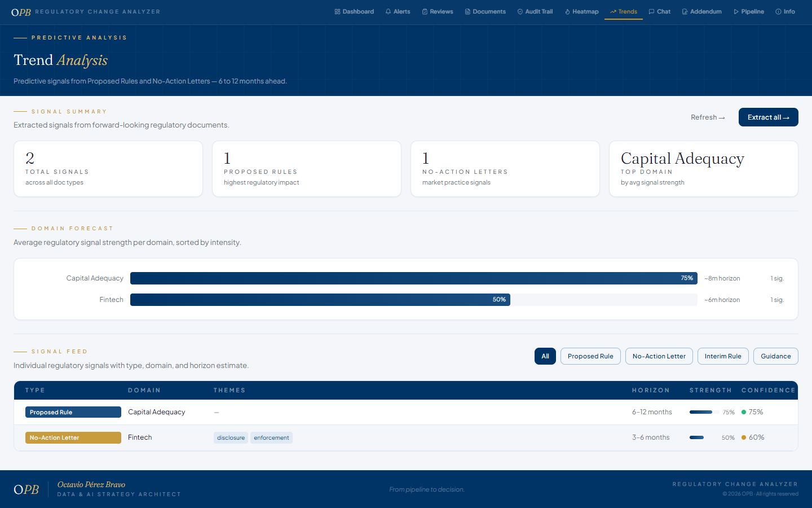 |
| **Policy chat** — answer with validated `[REG-n]`/`[CON-n]` citations 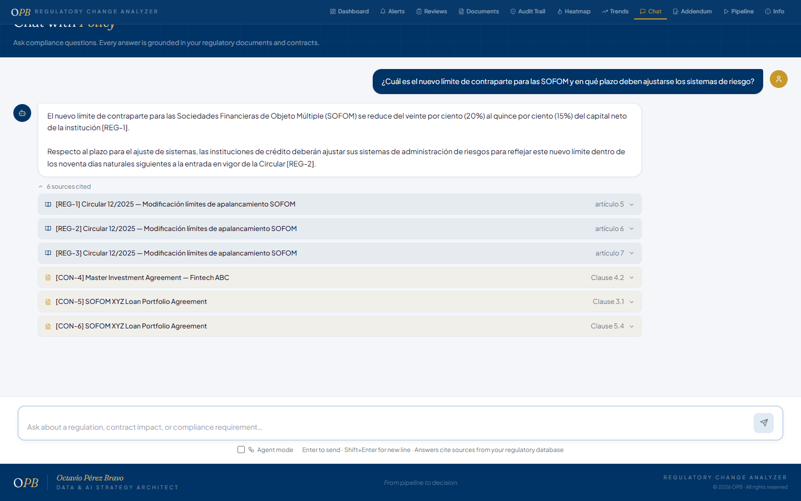 | **Research agent** — visible tool steps, multi-hop answer 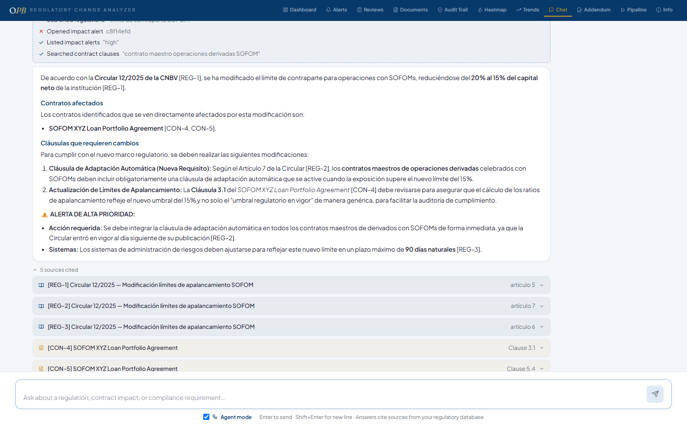 |
| **System refusal** — written by code when the answer cannot be grounded 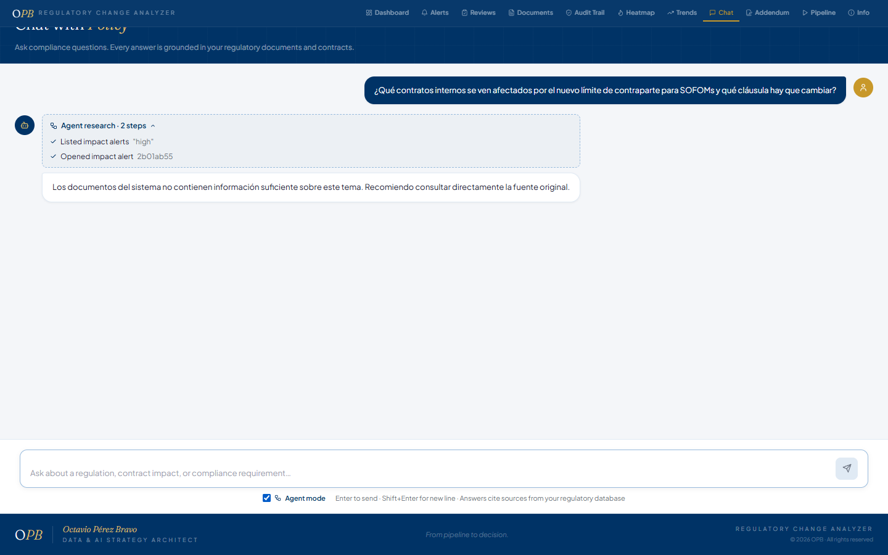 | **Drafting team** — per-contract drafter + reviewer verdicts 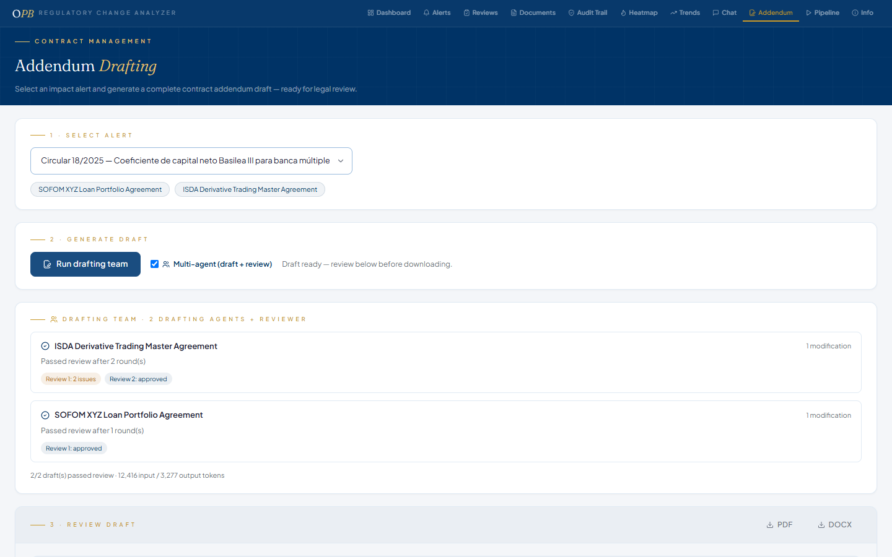 |
| **Drafted addendum** — cites the circular and the real clause 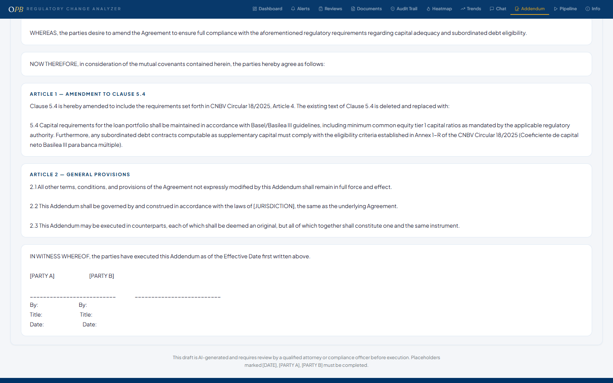 | **Pipeline** — run each stage from the browser 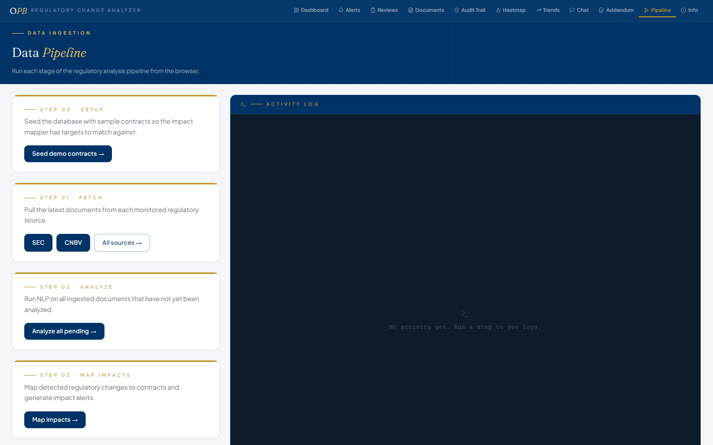 |
| **Audit trail** — append-only record of every step 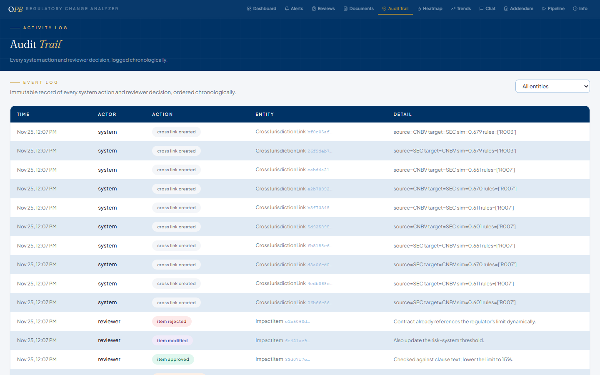 | |
